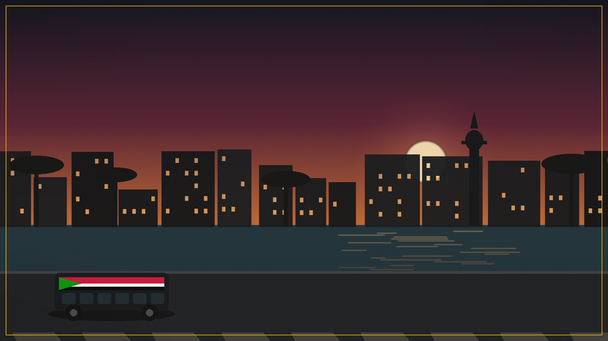
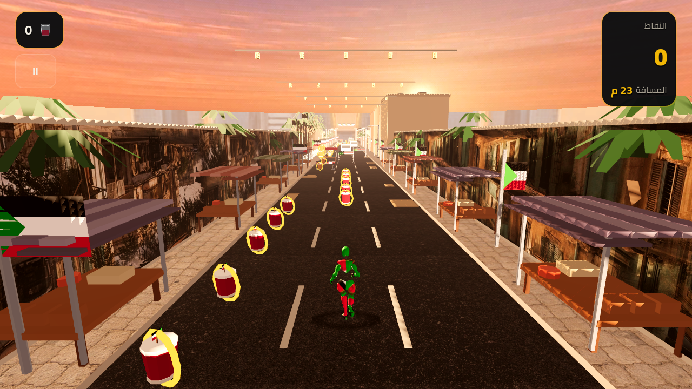
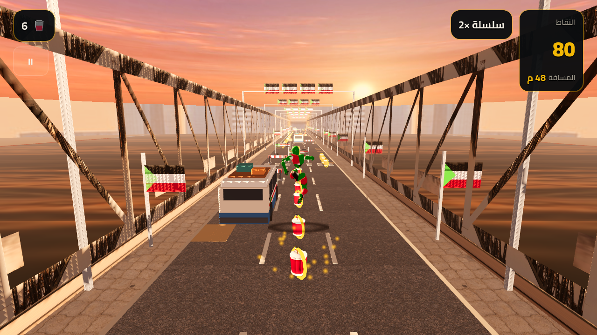
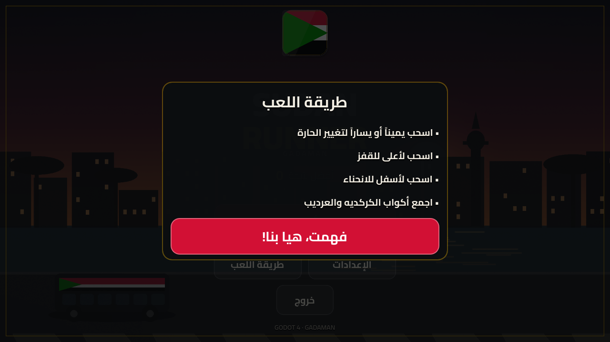
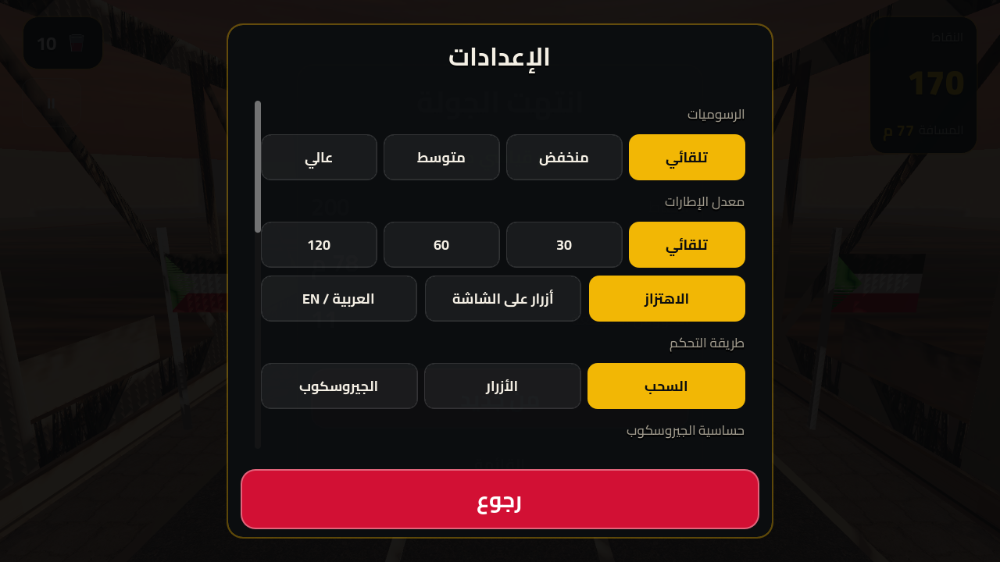
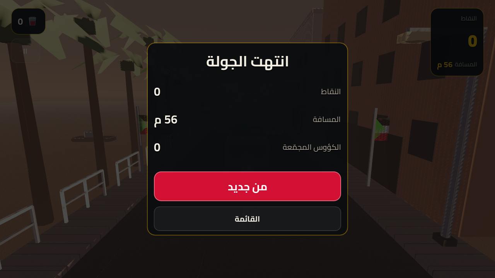
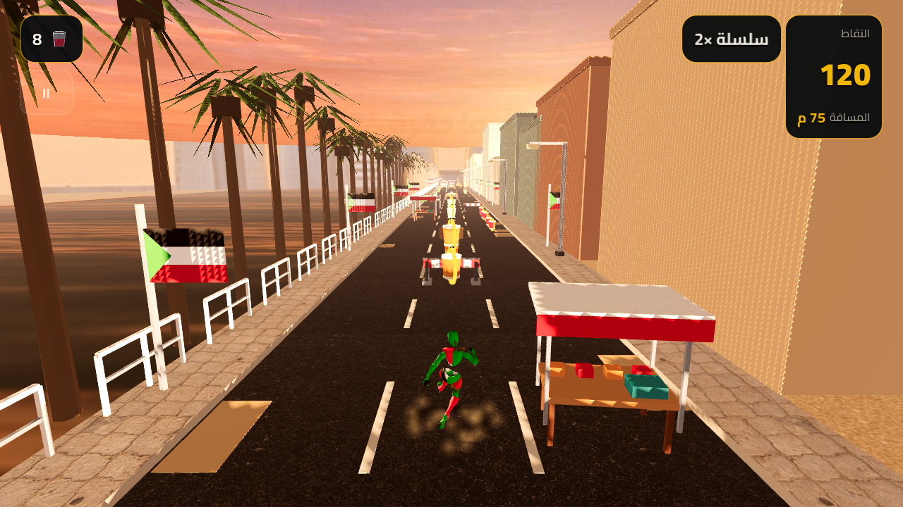
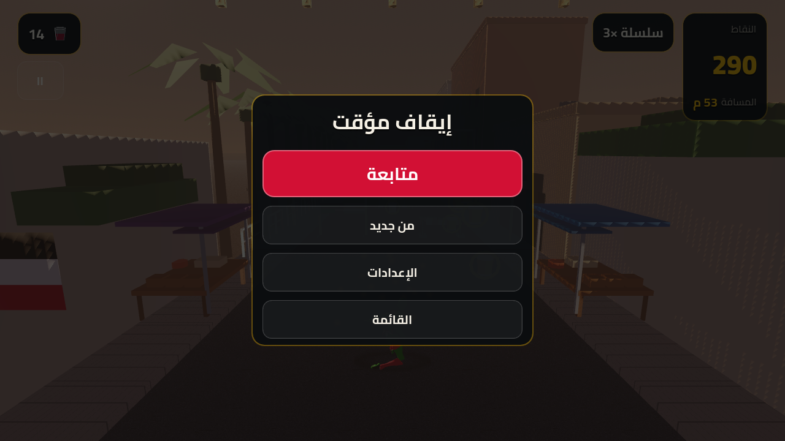

# عدّاء السودان · Sudan Runner (Gadaman)

لعبة **جري لا نهائي ثلاثية الأبعاد** لشوارع الخرطوم، مبنية بـ **Godot 4.4** ومهندسة لتعمل بسلاسة على هواتف أندرويد الضعيفة (2 GB RAM) والهواتف القوية (120 Hz) على حد سواء.
3D endless runner set in Khartoum, built with Godot 4.4 and tuned for Android — from 2 GB budget phones to 120 Hz flagships.

[](https://github.com/azmifatahi/gadaman/actions/workflows/build.yml)



## 📸 من داخل اللعبة / Screenshots

| اللعب / Gameplay | القفز / Jump |
| --- | --- |
|  |  |

| القائمة / Menu | الإعدادات / Settings | نهاية الجولة / Game over |
| --- | --- | --- |
|  |  |  |

| الانحناء / Slide | طريقة اللعب / How to play | إيقاف مؤقت / Pause |
| --- | --- | --- |
|  |  |  |

> هذه الصور مُلتقطة آليًا من بناء الـ CI نفسه (`godot --screenshot` مع مُصيّر برمجي) — أي أنها تعكس ما ستراه على الجهاز تمامًا.
> Captured automatically by CI from the real build on a software GL renderer.

---

## 1. ما داخل اللعبة / What is in the box

| العنصر | التفاصيل |
| --- | --- |
| المحرك | Godot **4.4.x** — GDScript فقط (لا C#، لا مكتبات خارجية) |
| المُصيّر | **GL Compatibility** (يعمل على أي GPU أندرويد تقريبًا + إقلاع أسرع + ذاكرة أقل) |
| الحجم | المشروع كامل ≈ 3 MB (كل الـ 3D مُولّد برمجيًا، لا نماذج مستوردة) |
| اللغة | العربية افتراضيًا + الإنجليزية (زر تبديل داخل الإعدادات، مع دعم RTL) |
| اللعب | جري تلقائي، 3 حارات، قفز، انحناء، جمع أكواب الكركديه والعرديب والقونقليز |
| الأداء | مدير أداء يفحص RAM/CPU/GPU/معدل تحديث الشاشة ويضبط الجودة تلقائيًا + دقة ديناميكية |

**الميزات:**

- 🏃 **شخصية مغلّفة بعلم السودان** (أحمر/أبيض/أسود + مثلث أخضر) مع عباءة علم ترفرف أثناء الجري.
- 🏙️ **توليد إجرائي لشوارع الخرطوم**: أسواق شعبية، كورنيش النيل، حواري طينية، جسر النيل الأزرق — 5 أنماط مشاهد تتناوب.
- 🎬 **حركة أكشن سينمائية**: تبديل حارات بالسرعة، ميلان كاميرا، FOV ديناميكي، تحطيم الصناديق عند السرعة القصوى، وتعثر مع استعادة التوازن بدل النهاية الفورية.
- 🚚 **نظام توصيل مرحلي**: API لمهمات توصيل العرديب/الكركديه/القونقليز لمسافة محددة قبل انتهاء الوقت بجانب الوضع اللانهائي.
- 🚌 **عوائق محلية**: حواجز الطرق، الحفر، عربات الكرو، الأمجد الواقفة، طاولات الباعة، صناديق السوق، وحواجز منخفضة للانحناء.
- 🥤 **مجموعات محلية**: أكواب الكركديه، العرديب، والقونقليز (مع نظام كومبو ×5).
- 🎵 **موسيقى ومؤثرات مولّدة برمجيًا** (إيقاع سوداني: دوم/تك/شيكر + خط لحن خماسي) — لا حقوق محفوظة.
- 📱 **تحكم مناسب للجوال**: سحب بالإصبع (يمين/يسار/أعلى/أسفل) + تحكم بالإمالة (اختياري) + لوحة مفاتيح للاختبار.
- ⚡ **بدون فيزياء وبدون GC أثناء اللعب**: تصادم حسابي، تجميع كائنات (pooling) لكل شيء، دقة ديناميكية.

---

## 2. طريقة التشغيل / Quick start

```bash
git clone https://github.com/azmifatahi/gadaman.git
cd gadaman
godot --editor      # أو افتح المشروع من مدير مشاريع Godot
```

ثم اضغط **F5**. (المطلوب: Godot 4.4 أو أحدث، بدون أي إضافات.)

على الجوال: شغّل اللعبة من Godot عبر **Remote Debug → Run on Android device**، أو حمّل APK جاهزًا من تبويب **Actions** في المستودع.

### التحكم / Controls

| الحركة | السحب (الافتراضي) | الأزرار | الجيروسكوب | لوحة المفاتيح |
| --- | --- | --- | --- | --- |
| تغيير الحارة | سحب يمين/يسار | سهمان أسفل يسار الشاشة | إدارة الجهاز يمينًا/يسارًا | ← → أو A/D |
| قفز | سحب لأعلى | زر ● أسفل يمين الشاشة | سحب لأعلى أو الزر | ↑ / W / مسافة |
| انحناء | سحب لأسفل | زر ● أسفل يمين الشاشة | سحب لأسفل أو الزر | ↓ / S |
| إيقاف مؤقت | زر الإيقاف | زر الإيقاف | زر الإيقاف | Esc |

طريقة التحكم تُختار من **الإعدادات → طريقة التحكم**، ويمكن تشغيل الأزرار مع السحب
معًا (`أزرار على الشاشة`). الجيروسكوب له مفتاح تشغيل/إيقاف ومنزلق حساسية وعكس اتجاه.

> في نمط الجيروسكوب أو الأزرار: الحارات بالجيروسكوب/الأزرار، لكن **القفز والانحناء
> يظلان متاحين بالسحب لأعلى/أسفل** أو بالأزرار، فلا تُغلق أي حركة على اللاعب.

---

## 3. البنية المعمارية / Architecture

```
gadaman/
├── project.godot                 # إعدادات المحرك + المدخلات + Autoloads
├── export_presets.cfg            # إعدادات تصدير APK (أيقونات العلم، اسم الحزمة)
├── scenes/main.tscn              # المشهد الوحيد: World + Player + Track + Camera + FX + UI
├── scripts/
│   ├── core/
│   │   ├── settings.gd           # حفظ الإعدادات (ConfigFile) + الاهتزاز
│   │   ├── localization.gd       # نصوص عربي/إنجليزي + RTL
│   │   ├── performance_manager.gd# كشف فئة الجهاز + دقة ديناميكية
│   │   ├── audio_manager.gd      # مشغّل صوت مجمّع (pool) بدون تخصيص أثناء اللعب
│   │   └── game_manager.gd       # حالة الجولة، النقاط، الكومبو، أفضل نتيجة
│   ├── player/
│   │   ├── player_controller.gd  # الحارات، القفز، الانحناء، السحب/الإمالة
│   │   ├── player_animation_handler.gd # تشغيل مقاطع الـ AnimationPlayer
│   │   ├── hero_material.gd      # بدلة العلم (Material آمن على gl_compatibility)
│   │   └── runner_model.gd       # نموذج احتياطي إجرائي (يظهر دائمًا)
│   ├── world/
│   │   ├── world.gd              # المنسّق: الإضاءة، الربط، دورة حياة الجولة
│   │   ├── track_manager.gd      # توليد المسار + تجميع العوائق + التصادم
│   │   ├── track_segment.gd      # مقطع شارع (pooled)
│   │   ├── track_prop.gd         # عائق (pooled)
│   │   ├── collectible.gd        # كوب قابل للجمع (pooled)
│   │   ├── segment_builder.gd    # توليد هندسة الشارع إجرائيًا (5 أنماط)
│   │   ├── prop_library.gd       # كتالوج العوائق والأكواب + بيانات اللعب
│   │   ├── mesh_kit.gd           # أدوات بناء هندسة (صندوق/أسطوانة/علم...)
│   │   ├── camera_rig.gd         # كاميرا مطاردة + اهتزاز + FOV متغير
│   │   └── fx.gd                 # جزيئات مجمّعة (غبار/لمعان/احتفال)
│   └── ui/
│       ├── ui_theme.gd           # ثيم الواجهة بالكود (خط Cairo، ألوان العلم)
│       └── ui_root.gd            # HUD + القوائم + الإعدادات + طريقة اللعب
├── assets/
│   ├── art/       (أيقونة العلم، خلفية القائمة، الشعار، أكواب HUD)
│   ├── textures/  (أسفلت، رمل، علم، ظل، دخان)
│   ├── audio/     (موسيقى + 9 مؤثرات OGG)
│   ├── characters/الشخصية/  (مجلد الشخصية: Run Forward + Jump + Slide + …)
│   ├── models/hero/hero.tscn  (مُولَّد آليًا من مجلد الشخصية — غير مُتتبَّع في git)
│   └── fonts/     (Cairo — SIL OFL)
├── tools/
│   ├── generate_assets.py        # يعيد توليد كل الصور (Pillow)
│   ├── generate_audio.py         # يعيد توليد الموسيقى والمؤثرات (numpy + ffmpeg)
│   ├── ci_build_hero.gd          # يبني hero.tscn من مجلد الشخصية (CI/المحرر)
│   ├── ci_verify_hero.gd         # يتحقق أن الشخصية فعلاً تُرسم (صارم في CI)
│   └── ci_configure_android.py   # يضبط مسارات Android SDK في CI
└── .github/workflows/build.yml   # فحص + اختبار headless + تصدير APK
```

### تدفّق اللعبة / Game flow

```
UI (زر ابدأ) ──play_requested──▶ World ──▶ Game.start_run() + Track.start_run() + Player.start_running()
Track._process:  يحرّك العالم ◀ التصادم/الجمع ◀ Game.add_distance / collect_cup / end_run
Game.state_changed ──▶ UI (HUD ⇄ Pause ⇄ Game Over)
Track.prop_hit ──▶ World: Player.die() + Camera.shake() + FX.crash() + Toast
```

اللاعب **لا يتحرك للأمام**؛ الشارع هو الذي يتحرك نحوه. كل العوائق والأكواب تُعاد إلى مخزنها (pool) بعد تجاوزها، لذلك لا يوجد تخصيص ذاكرة أثناء الجري.

### النقاط / Scoring

| المصدر | القيمة |
| --- | --- |
| المسافة | +1 نقطة لكل متر |
| الكوب | 10 × المضاعف (1 → 5) |
| الكومبو | كل 5 أكواب متتالية (خلال 2.2 ثانية) ترفع المضاعف |
| الإنجاز | كل 250 متر: مؤثر صوتي + اهتزاز + احتفال بصري |

---

## 3.1 الشخصية / The runner character

**مجلد الشخصية هو المصدر الوحيد للشخصية:**
`assets/characters/الشخصية/` (FBX من Mixamo). اللعبة **لا** ترسم مجسمًا مبرمجًا
عندما تكون الشخصية الحقيقية متاحة، وتستخدم `RunnerModel` كخطة بديلة فقط.

| الملف | الاستخدام |
| --- | --- |
| `Run Forward.fbx` | هو الملف الوحيد الذي يحتوي على **مجسم + هيكل عظمي** (Skin) — يُستخدم كجسم الشخصية، وحركته تُستخدم كـ `jog`. |
| `Jump.fbx` · `Running Slide.fbx` · `Jogging Stumble.fbx` · `Falling To Landing.fbx` | مقاطع حركة فقط (بدون Skin) → `jump` · `slide` · `stumble` · `fall` (+ `land`). |

### كيف تُبنى الشخصية؟

```bash
# المحرر: افتح scripts/tools/ImportArabicFolderHero.gd واضغط Ctrl+Shift+X
# أو من سطر الأوامر (نفس ما يفعله CI):
godot --headless --import
godot --headless --script tools/ci_build_hero.gd -- --strict
godot --headless --script tools/ci_verify_hero.gd -- --strict
```

`HeroBuilder` يقوم بالتالي:

1. **يفحص محتوى كل ملف** (عدد الرؤوس والعظام) — لا يعتمد على اسم الملف أو حجمه
   ولا على قراءة بايتات من الـ FBX، لأن ملفات `.fbx` غير موجودة أصلاً داخل APK.
2. يختار الملف الذي يحتوي على أكبر مجسم = **الجلد (Skin)**.
3. **يعيد توجيه (Retarget)** كل مسارات الحركة من هيكل ملف المقطع إلى هيكل الشخصية
   (`Mesh/<Skeleton>:<Bone>`)، ويحوّل مسارات العقد العادية إلى مسارات عظام
   (مقاطع Mixamo "Without Skin" تُصدَّر كعقد Node3D عادية).
4. يطبّع الارتفاع إلى **1.78 م**، يضع القدمين على `Y=0`، ويدير الشخصية لتنظر
   بعيدًا عن الكاميرا (`-Z`).
5. **يعيّن `owner` لكل عقدة قبل `PackedScene.pack()`** — بدون ذلك يحذف Godot
   الشجرة كاملة عند الحفظ (هذا سبب اختفاء الشخصية في 1.2.x).
6. **يختار الـ Take المتحرّك لا الساكن:** ملفات Mixamo تحتوي عادة على مقطعين:
   `mixamo.com` (الحركة الحقيقية) و`Take 001` (نسخة ساكنة بطول كامل من وضع
   الـ T-pose). الاختيار القديم كان يعدّ المسارات فقط فيأخذ `Take 001` ويشحن
   شخصية متجمّدة؛ الآن يُقيَّم كل مقطع بعدد المفاتيح المتغيّرة فعليًا.
7. **يقرأ المشهد المحفوظ ويتحقق منه** (`verify()`): مجسم مرئي، ارتفاع منطقي،
   هيكل عظمي غير منهار، وكل الحركات المطلوبة قابلة للتشغيل. ثم **يشغّل كل مقطع
   فعليًا** ويعدّ العظام التي تغيّر وضعها بين لحظتين داخل المقطع — لأن وجود
   المسارات لا يعني وجود حركة. لو فشل أي شرط يفشل بناء الـ APK.

> 🎬 **لا يوجد `AnimationTree` في اللعبة.** المشهد يحتوي `AnimationPlayer` واحدًا
> فقط، و`PlayerAnimationHandler` هو من يشغّل المقاطع (idle → jog → sprint بحسب
> سرعة المسار، وjump/fall/land/slide/stumble لمرة واحدة). السبب: `tree_root` لا
> ينجو دائمًا من `PackedScene.pack()`، وشجرة فارغة تتجاوز الـ AnimationPlayer
> وتُجمّد الهيكل — وهذا بالضبط سبب وضع الـ T-pose في 1.2.2.

> 🛟 **شبكة أمان مزدوجة:** `PlayerController` يتحقق أيضًا من `hero.tscn` وقت
> التشغيل؛ إن كان فارغًا أو غير قابل للرسم يستخدم `RunnerModel` الإجرائي فورًا،
> فلا يمكن أن تختفي الشخصية مرة أخرى.

**ملاحظات مهمة:**

* لا تُشغّل بناء الشخصية وقت التشغيل داخل APK: ملفات الـ FBX الأصلية ليست
  موجودة في الحزمة — البناء يحدث في CI/المحرر فقط.
* أسماء الملفات ليست مقدّسة: أي اسم يحتوي `run`/`jump`/`slide`/`stumble`/`fall`
  سيُصنَّف تلقائيًا. أضف `idle`/`sprint` لو أردت حركات مخصّصة (تُولَّد تلقائيًا
  إن غابت).
* بدلة العلم تُستخدم بمعدن منخفض (`metallic = 0.05`) عن قصد: على
  `gl_compatibility` لا توجد انعكاسات، والمعدن العالي يجعل الشخصية سوداء تكاد
  لا تُرى على الأسفلت ليلاً.

---

## 4. إدارة الأداء / Performance manager

`scripts/core/performance_manager.gd` يقرأ: ذاكرة RAM (`OS.get_memory_info`)، عدد الأنوية، اسم GPU (`RenderingServer.get_video_adapter_name`)، معدل تحديث الشاشة، الدقة و DPI — ثم يصنّف الجهاز:

| | **منخفض** (2–4 GB) | **متوسط** (4–6 GB) | **عالي** (8 GB+) |
| --- | --- | --- | --- |
| الظلال | مُطفأة + ظل بسيط تحت الشخصية | ظل باتجاهي 32 م | ظل 70 م + أطلس 2048 |
| الدقة الداخلية | 0.78× | 0.92× | 1.0× |
| MSAA | معطّل | معطّل | 2× |
| الضباب | ضباب كثيف (118 م) | 195 م | 250 م |
| كثافة الزينة | 55% | 100% | 135% |
| الجزيئات | 45% | 80% | 100% |
| سقف FPS | 30 | 60 | معدل الشاشة (حتى 120) |
| التظليل | per-vertex | per-pixel | per-pixel + تعديل ألوان |

- **Auto**: يُطبّق الفئة المكتشفة. اللاعب يستطيع تجاوزها من الإعدادات (Auto/Low/Medium/High) — يُحفظ الاختيار.
- **دقة ديناميكية**: إذا نزل FPS عن 82% من الهدف مرتين متتاليتين تُخفّض الدقة 0.08 حتى حد 0.55، وتعود تدريجيًا عند توفر فائض. مُعطّلة عند اختيار جودة يدوية.
- **سقف FPS** = `Engine.max_fps`، ويُقصّ إلى معدل تحديث الشاشة لتوفير البطارية.

لماذا **Compatibility** بدل Mobile/Vulkan؟ لأنه الوحيد الذي يضمن التشغيل من Android 7 على GPUs قديمة بدون تعطّل، وأقل استهلاكًا للذاكرة — وهو أهم من فروق الإضاءة في لعبة أركيد سريعة.

---

## 5. الثيم السوداني / The Sudanese layer

- **العلم**: مرسوم بدقة عبر `MeshKit.add_flag_panel` (ثلاثة أشرطة + مثلث أخضر بنسبة 1:2 الصحيحة)، ويظهر على: بدلة العدّاء، عباءته، لافتات الشوارع، حافلات الأمجد، وحواجز الانحناء.
- **البيئة**: مآذن وقباب، أكاسيا مسطحة التاج، نخيل الكورنيش، بيوت طين ببوابات ملوّنة، أطنان الماء على الأسطح، حبال غسيل، لمبات معلّقة في السوق، عربات الكرو، والأمجد.
- **الأكواب**: كركديه (أحمر)، عرديب (عنبري)، قونقليز (كريمي) — كلها تعمل كعملات لجمع النقاط.
- **الصوت**: دوم/تك/كلاب/شيكر + باص + لحن خماسي (D مينور) بمقاربة كرابلس-سترونغ، كله مُولّد بـ`numpy` ثم OGG.

إعادة التوليد بعد أي تعديل:

```bash
pip install pillow numpy
python3 tools/generate_assets.py          # كل الصور والأيقونات
FFMPEG_BIN=$(which ffmpeg) python3 tools/generate_audio.py   # الموسيقى والمؤثرات
```

---

## 6. بناء APK / Building the APK

### أ) عبر GitHub Actions (الأسهل — لا تحتاج تثبيت أي شيء)

كل `push` إلى `main` أو أي فرع `arena/**` (أو Pull Request) يشغّل:

1. **Validate** — فحص GDScript + استيراد المشروع + **اختبار لعب headless** (يبدأ جولة، يقفز، ينحني، يغيّر الحارات، ينهي الجولة، ويطبع `SMOKE_OK`).
2. **Export APK** — يثبّت Android SDK (build-tools 34/35) ويصدّر APK موقّعًا بمفتاح التصحيح.

للتحميل مباشرة (بدون تسجيل دخول):
**[⬇️ أحدث APK (v1.3.0)](../../releases/latest/download/sudan-runner.apk)** — الرابط ثابت ويشير دائمًا إلى آخر بناء ناجح، فلا يحتاج تحديثًا مع كل إصدار. يمكنك أيضًا التحميل من صفحة الإصدار [`latest-build`](../../releases/tag/latest-build)، أو من **Actions → آخر تشغيل → Artifacts → `sudan-runner-apk`**.

| | |
| --- | --- |
| الإصدار | **1.3.0** (`versionCode 7`) |
| الحجم | ~56 ميجابايت (arm64-v8a + armeabi-v7a) |
| المتطلبات | أندرويد 7.0 أو أحدث |

ولإنشاء إصدار رسمي مُوسَّم: أنشئ وسمًا مثل `v1.3.0`:

```bash
git tag v1.3.0 && git push origin v1.3.0
```

سيُرفق الـ APK تلقائيًا بصفحة **Releases**.

> ⚠ **ملاحظة الترقية من v1.0.0 إلى v1.1.0**: تم تبديل شهادة توقيع الـ APK في CI إلى شهادة ثابتة (تُحفَظ في `actions/cache`) حتى تتثبّت التحديثات المستقبلية فوق القديمة بدون حذف. للانتقال من 1.0.0 القديم إلى 1.1.0: احذف النسخة القديمة من إعدادات الهاتف أولاً، ثم ثبّت 1.1.0 (نتائجك المحفوظة لن تفقد لأن `retain_data_on_uninstall=true` مُفَعّل من 1.1.0 فما فوق). من 1.1.0 فصاعدًا، ستعمل التحديثات الهوائية مباشرة.

### ب) محليًا

```bash
# 1) ثبّت قوالب التصدير: Editor → Manage Export Templates → Download and Install
# 2) ثبّت Android SDK + JDK 17، ثم في Godot:
#    Editor → Editor Settings → Export → Android → android_sdk_path / java_sdk_path
mkdir -p build
godot --headless --import
godot --headless --export-debug   "Android" build/sudan-runner-debug.apk
# إصدار مُوقّع للنشر:
godot --headless --export-release "Android" build/sudan-runner.apk
```

### ج) تصدير إصدار موقّع بمفتاحك (Play Store)

```bash
keytool -genkeypair -v -keystore release.keystore -alias sudanrunner \
  -keyalg RSA -keysize 2048 -validity 10000
# ثم أدخل المسار وكلمة المرور في:
# Project → Export → Android → Keystore (release)
```

---

---

## 7. الجديد في 1.3.0 / What's new in 1.3.0

### أ) شوارع الخرطوم بصور حقيقية لا كرتونية

كل الفن الآن مبني من صور مرجعية في `art_src/` تمرّ عبر
`tools/build_textures.py`:

| الأصل | الاستخدام في اللعبة |
| --- | --- |
| `khartoum_skyline.jpg` | سماء بانورامية حقيقية (`sky_khartoum.jpg`) + أفق الخرطوم على أسطوانة بعيدة (`skyline_khartoum.png`) |
| `asphalt.jpg` | أسفلت الشارع (albedo + normal + roughness) |
| `pavement.jpg` | الرصيف |
| `bahri_street.jpg` | واجهات المتاجر والمباني (أطلس 3 أنماط) |
| `nile_water.jpg` | سطح النيل في الكورنيش والكباري |
| `bridge_mac_nimir.jpg` | جسور الحديد (truss) لكبري المك نمر |
| `bridge_shambat.jpg` | الخرسانة والأعمدة لكبري شمبات |

**المناطق القابلة للاختيار من الإعدادات:** شارع الخرطوم · سوق شعبي · كورنيش النيل ·
حوش سوداني · **كبري المك نمر** · **كبري شمبات** · **شوارع بحري العتيقة** ·
أو "تلقائي" ليمرّ اللاعب بينها كلها.

`tools/ci_world_check.gd` يبني المناطق السبع كلها في CI ويفشل البناء لو فقد أي
سطح نسّيجه (UV) أو صار فارغًا.

### ب) الجيروسكوب (تشغيل/إيقاف + حساسية)

من **الإعدادات → طريقة التحكم → الجيروسكوب**:

* يعمل على معدل دوران الجهاز (rad/s) لا على زاوية الميل، فلا يحتاج معايرة ولا
  ينجرف مع الوقت.
* **مفتاح تشغيل/إيقاف**، ومنزلق **حساسية** (0.4× إلى 2.5×)، وخيار **عكس الاتجاه**.
* على الأجهزة التي لا تحتوي جيروسكوبًا يعود تلقائيًا إلى مقياس التسارع.
* في `project.godot`: `sensors/enable_gyroscope` و`sensors/enable_accelerometer`.

### ج) أزرار بدل السحب — واللاعب يختار

ثلاثة أنماط في **الإعدادات → طريقة التحكم**:

1. **السحب** — كما كان (اسحب يمين/يسار/أعلى/أسفل في أي مكان).
2. **الأزرار** — لوحة أزرار شفافة أسفل الشاشة: سهمان للحارات + قفز + انزلاق.
3. **الجيروسكوب**.

ويمكن تشغيل **الأزرار مع السحب معًا** (`show_buttons`) لمن يريد ذلك؛
الأزرار لا تحجب اللمس عن بقية الشاشة (`MOUSE_FILTER_IGNORE` على الحاوية).

## 8. التخصيص السريع / Tuning cheatsheet

| ما تريده | المكان |
| --- | --- |
| صعوبة أسرع/أبطأ | `track_manager.gd`: `BASE_SPEED`, `MAX_SPEED`, `SPEED_PER_METER` |
| مسافة رد الفعل | `track_manager.gd`: `gap = clampf(speed * 0.62, 9.5, 20.0)` |
| ارتفاع القفز | `player_controller.gd`: `JUMP_VELOCITY` و `GRAVITY` |
| مدة الانحناء | `player_controller.gd`: `SLIDE_TIME` |
| أداء الجوال الضعيف | `performance_manager.gd`: كتلة `Tier.LOW` |
| ألوان البيئة | `segment_builder.gd`: قاموس `PALETTE` |
| سرعة التوليد البصري | `track_manager.gd`: `_spawn_row()` |
| النصوص العربية | `scripts/core/localization.gd` |

---

## 9. الاختبار / Testing

```bash
# اختبار لعب كامل بلا شاشة (يُستخدم في CI)
godot --headless --quit-after 1200 -- --smoke

# فحص صياغة كل السكربتات
pip install "gdtoolkit>=4,<5" && for f in $(find scripts -name '*.gd'); do gdparse "$f"; done
```

---

## 10. الترخيص والشكر / License & credits

- الكود: MIT.
- خط **Cairo** — SIL Open Font License 1.1 (`assets/fonts/OFL.txt`).
- كل الصور والأصوات في هذا المستودع **مولّدة برمجيًا** بواسطة سكربتات `tools/`، ولا تحتوي على أي أصول محفوظة الحقوق.
- مستوحاة من كلاسيكيات الجري اللانهائي، لكن كل المحتوى سوداني أصلي.

صنع بـ ❤️ لمشروع **gadaman**.

### ترقية الرسومات الواقعية / Semi-realistic art upgrade

راجع [`docs/ASSET_IMPORT_GUIDE.md`](docs/ASSET_IMPORT_GUIDE.md) لخطوات Mixamo/GLB
وتشغيل مقاطع الحركة (AnimationPlayer) وتراخيص Poly Pizza/Sketchfab. يمكن تشغيل
`scripts/tools/SetupRealisticRunner.gd` من محرر Godot بعد تحديد نموذج البطل لتطبيق
بدلة السودان المعدنية وReflectionProbe تلقائياً.
